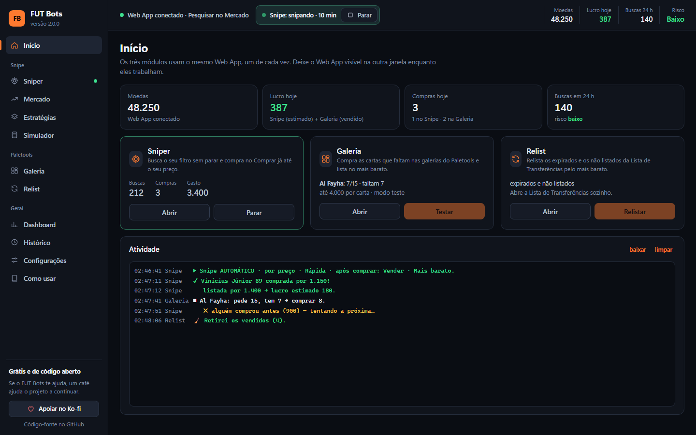
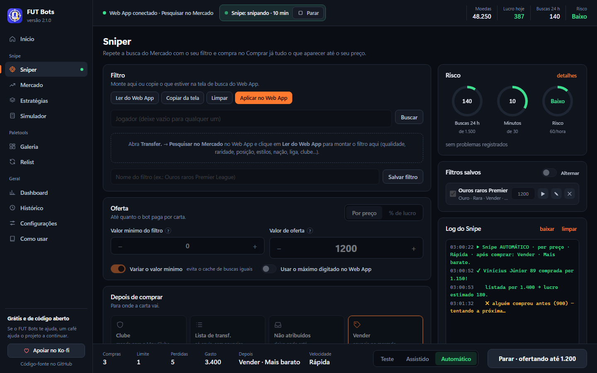
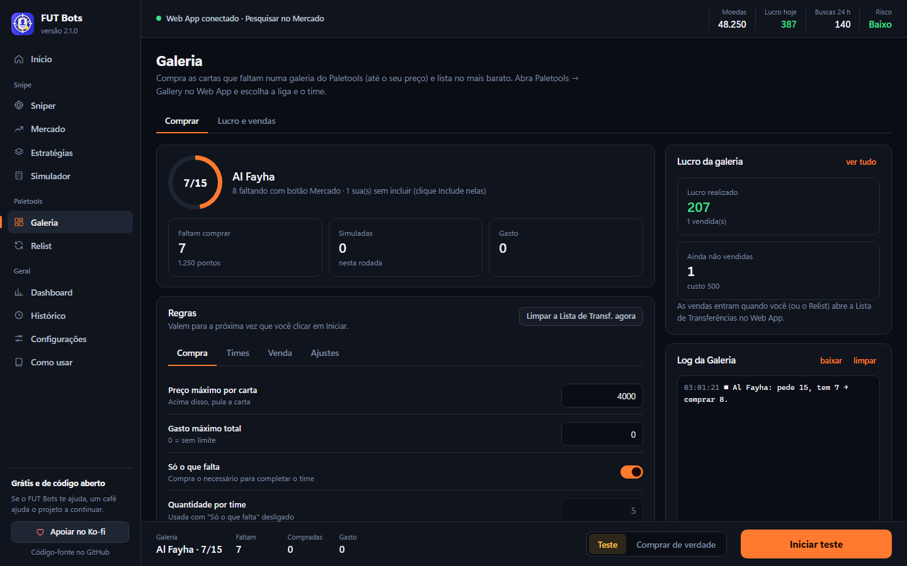
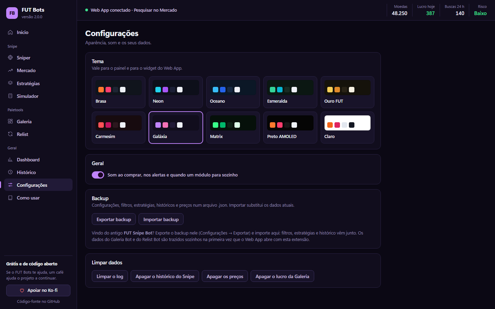

# FUT Bots

Extensão **gratuita e de código aberto** para o Chrome com três ferramentas para o **EA FC Ultimate Team Web App**, controladas por um painel só:

| Módulo | O que faz |
| --- | --- |
| **Sniper** | Repete a busca do Mercado com o seu filtro e compra no **Comprar já** tudo o que aparecer até o seu preço. Depois manda a carta para o clube ou para a Lista de Transferências, deixa nos não atribuídos ou vende. |
| **Galeria** | Completa as galerias do **Paletools**: compra as cartas que faltam (até o seu preço), lista no mais barato e passa para o próximo time. |
| **Relist** | Abre a Lista de Transferências, retira os vendidos e anuncia de novo os expirados e os não listados pelo "Mais barato". |

O painel também tem dashboard de lucro e banca, histórico, gráfico de preços por filtro, simulador de lucro, estratégias prontas, 10 temas e 3 idiomas (**português, inglês e espanhol**, no seletor PT / EN / ES do topo).

<table><tr>
<td></td>
<td></td>
<td></td>
</tr><tr><td align="center">Sniper</td><td align="center">Galeria</td><td align="center">Temas</td></tr></table>

Imagens com dados de exemplo.

> ⚠️ **Aviso importante:** a EA proíbe automação no Web App. Usar esta extensão pode levar a restrições no mercado ou até ao banimento da sua conta. Use com moderação e **por sua conta e risco**. Este projeto não tem nenhuma ligação com a EA nem com o Paletools.

---

## O que você precisa

- **Google Chrome** no computador (também funciona no Edge, Brave, Opera e outros baseados em Chromium)
- **Paletools** instalado e funcionando no Web App (a Galeria e a venda no "Mais barato" usam ele)
- Web App em **português, inglês ou espanhol** (o painel é em português)

---

## Passo 1: instalar

1. **Baixe:** pegue o arquivo `fut-bots-v….zip` na [última versão](../../releases/latest) (ou clique em **Code → Download ZIP** no topo desta página).
2. **Extraia o ZIP** (botão direito → **Extrair tudo**) e guarde a pasta num lugar fixo, como `Documentos`. **Se apagar ou mover a pasta, a extensão para de funcionar.**
3. Abra `chrome://extensions`, ligue o **Modo do desenvolvedor** (canto superior direito) e clique em **Carregar sem compactação**.
4. Selecione a pasta extraída (a que tem o `manifest.json` dentro).
5. Fixe o **FUT Bots** na barra do Chrome (ícone de quebra-cabeça).

> **Usava o FUT Galeria Bot, o FUT Relist Bot ou o FUT Snipe Bot?** Remova as extensões antigas em `chrome://extensions` para elas não rodarem junto com esta.
> - As configurações e o histórico de lucro do **Galeria Bot** e do **Relist Bot** são trazidos sozinhos na primeira vez que você abre o Web App com o FUT Bots.
> - Do **Snipe Bot**: antes de remover, exporte o backup nele (Configurações → Exportar backup) e importe no FUT Bots (Configurações → Importar backup).

---

## Passo 2: abrir

1. Abra o [EA FC Web App](https://www.ea.com/ea-sports-fc/ultimate-team/web-app/) e faça login. Um widget pequeno aparece no canto da tela (se não aparecer, aperte F5).
2. Clique no **ícone da extensão** (ou no botão de painel do widget) para abrir o **painel** numa janela própria.
3. **Deixe o Web App visível** na outra janela, lado a lado com o painel. Se ele ficar minimizado ou numa aba escondida, o Chrome desacelera os módulos.

Só **um módulo trabalha por vez**. O topo do painel mostra quem está rodando e tem o botão **Parar**. O widget do Web App também inicia e para qualquer um dos três.

---

## Sniper

1. No Web App, abra **Transfer. → Pesquisar no Mercado** (jogadores ou consumíveis).
2. No painel → **Sniper**, clique em **Ler do Web App** e monte o filtro aqui, ou monte no Web App e clique em **Copiar da tela**. Ao clicar em **Snipar**, o filtro do painel é aplicado no Web App (se nada estiver escolhido no painel, vale o que está na tela). Dá para salvar vários filtros e alternar entre eles.
   - As listas do filtro se atualizam sozinhas: raridades e eventos novos entram quando aparecem no Web App, e as listas são lidas de novo a cada 12 horas.
3. Defina a **oferta**: preço fixo ou **% de lucro** sobre o preço de mercado (o bot confere o mercado sozinho).
4. Escolha **depois de comprar**: Clube, Lista de transf., Não atribuídos ou Vender (Mais barato do Paletools, preço fixo ou % sobre o que pagou). Cada filtro salvo guarda o próprio destino.
5. Ajuste o ritmo (velocidade, buscas por rodada, descanso, limite diário) ou carregue uma **estratégia** pronta.
6. Escolha **Teste**, **Assistido** ou **Automático** na barra de baixo e clique em **Snipar**.

| Modo | O que faz |
| --- | --- |
| **Teste** | Faz as buscas, mas não compra. Registra o que compraria e o lucro projetado (Dashboard → Carteira virtual). |
| **Assistido** | Acha a oferta e espera você clicar em **Comprar** (no painel ou no widget). |
| **Automático** | Compra sozinho. |

Quando alguém compra antes ("Status do lance alterado…"), o Sniper tenta a próxima oferta e volta a buscar, **sem parar**. Um aviso de limite do EA pausa o snipe por alguns minutos; três avisos em 15 minutos param de vez.

---

## Galeria

1. No Web App, abra **Paletools → Gallery** e escolha a **Category** (liga) e o **Set** (time).
2. No painel → **Galeria**, confira o anel (ex.: **7/15**) e quantas cartas **faltam comprar**.
3. Ajuste as regras e comece pelo **Teste**; quando estiver tudo certo, troque para **Comprar de verdade** e clique em **Iniciar**.

> Tem cartas no clube que ainda não foram incluídas na galeria? Clique em **Include** nelas antes, para o bot não comprar o que você já tem.

| Aba | Opção | O que faz |
| --- | --- | --- |
| Compra | **Preço máximo por carta** | Se a mais barata do mercado passar disso, pula a carta. |
| Compra | **Gasto máximo total** | Teto de moedas para a rodada inteira. `0` = sem limite. |
| Compra | **Só o que falta** | Calcula sozinho quanto comprar (pede 15, tem 7 → compra 8). Recomendado. |
| Times | **Ir para o próximo time** | Ao terminar, abre o próximo da lista e pula os completos. |
| Times | **Máximo de times** | `0` = até o fim da liga. |
| Venda | **Listar no mais barato** | Logo depois de comprar: Listar no Mercado → Mais barato → Listar. |
| Venda | **Não listar abaixo de** | Proteção contra prejuízo: abaixo disso, a carta fica nos não atribuídos. |
| Venda | **Limpar quando encher** | Se a Lista de Transferências lotar: registra as vendas, retira os vendidos, envia os não repetidos ao clube e volta para a galeria. |
| Ajustes | **Pausa entre ações** | Em milissegundos. Mais alto = mais lento e mais seguro. |
| Ajustes | **Ofertas por carta** | Se alguém comprar antes, quantas vezes tentar a próxima mais barata. |

Em **Galeria → Lucro e vendas** ficam as compras, vendas e o lucro por período, com exportação em `.csv`. As vendas são reconhecidas quando a Lista de Transferências é aberta no Web App; se alguma não for, use **marcar venda**.

---

## Relist

No painel → **Relist**, escolha o que relistar (expirados, não listados), o preço mínimo e clique em **Relistar agora**, de qualquer tela do Web App. Anúncios ativos e itens vendidos nunca são mexidos.

---

## Os módulos param sozinhos quando

- aparece um **captcha** (resolva e inicie de novo);
- as **moedas acabam** ou um limite seu é atingido (gasto, compras, tempo, buscas por dia);
- os **não atribuídos** enchem;
- a EA **limita o mercado** (o Sniper pausa antes; a Galeria e o Relist param).

---

## Problemas comuns

| Problema | Solução |
| --- | --- |
| O widget não aparece / "o bot não respondeu" | Recarregue o Web App (F5). Confira em `chrome://extensions` se o FUT Bots está ativado e se as extensões antigas foram removidas. |
| "Abra Pesquisar no Mercado" | O Sniper precisa da tela **Transfer. → Pesquisar no Mercado** aberta. |
| "Abra a Gallery" | Abra Paletools → **Gallery** e escolha a liga e o time. |
| Não acha os botões | Confira se o Web App está em português, inglês ou espanhol e se o Paletools está ativo. Se continuar, abra uma [issue](../../issues) com o idioma e o texto do botão. |
| Captcha com frequência | Use uma velocidade menor, descansos maiores e um limite de buscas por dia. |

---

## Como atualizar

Quando sai uma versão nova, o painel mostra uma faixa **"Versão X disponível"** com os botões **Baixar** e **Recarregar**:

1. Clique em **Baixar** e extraia o ZIP.
2. Copie os arquivos da pasta nova por cima da pasta atual da extensão, substituindo tudo.
3. Clique em **Recarregar** na faixa (ou no ↻ do FUT Bots em `chrome://extensions`) e aperte F5 no Web App.

Suas configurações e históricos são mantidos, porque ficam guardados no Chrome e não na pasta.

> Quando o FUT Bots estiver na **Chrome Web Store**, quem instalar por lá recebe as versões novas sozinho.

---

## Apoie o projeto

O FUT Bots é e vai continuar sendo **grátis**. Se ele te ajudou e você quiser apoiar o desenvolvimento, qualquer valor é bem-vindo:

A doação é opcional e não libera nenhuma função extra.

---

## Para quem quer mexer no código

| Arquivo | O que tem |
| --- | --- |
| `core.js` | Núcleo que roda no Web App: textos dos botões e telas (dicionário `T`, em pt/en/es), cliques, venda, Lista de Transferências, log e a trava de um módulo por vez. |
| `snipe.js`, `galeria.js`, `relist.js` | Um motor por módulo. |
| `widget.js` | O widget que aparece no Web App. |
| `control.html` / `.css` / `.js`, `control-mods.js` | O painel. |
| `lib.js` | Constantes e contas compartilhadas (escada de preços, temas, estratégias). |

Se a EA mudar algum texto ou você quiser adicionar outro idioma, ajuste o dicionário `T` no `core.js`. Achou um bug ou tem uma ideia? Abra uma [issue](../../issues) ou mande um *pull request*.

## Privacidade

Tudo fica no seu computador: a extensão não coleta nem envia seus dados. Veja a [política de privacidade](PRIVACIDADE.md).

## Licença

[MIT](LICENSE): use, modifique e distribua à vontade, mantendo o crédito.
